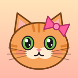
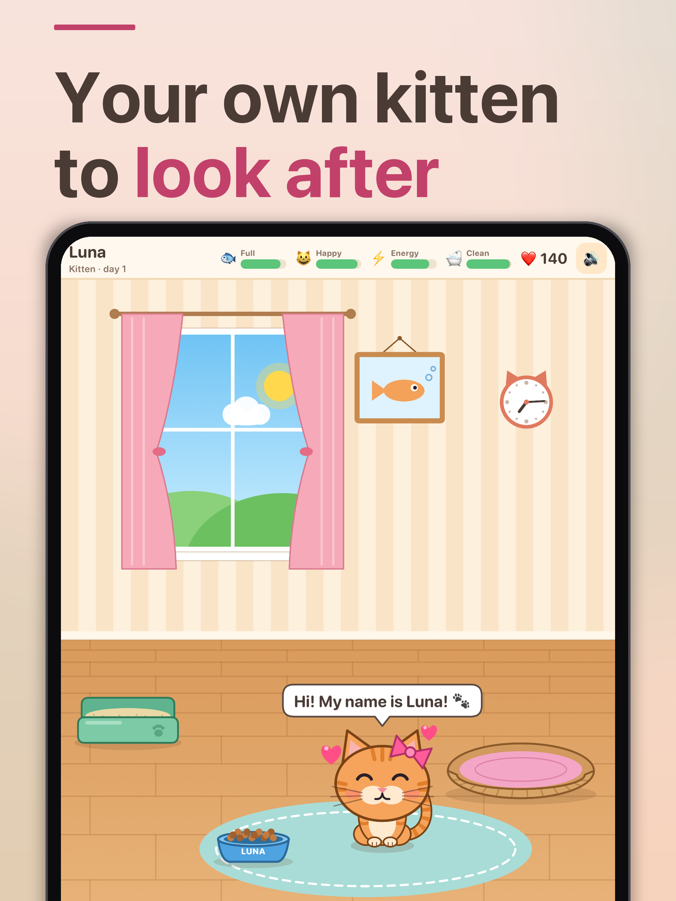
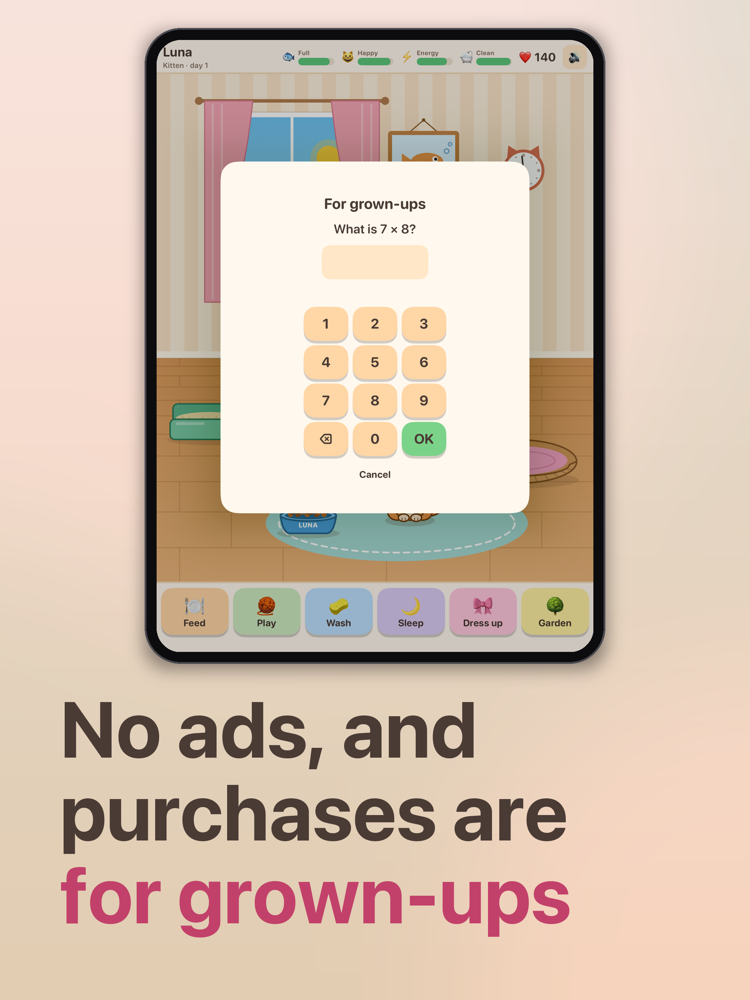

# Whiskerling

Pet care game for kids, no ads

  Coming to the App Store · Free, with one optional purchase · iPadOS 17 or later · <a href="https://whiskerling.iamjarl.com">whiskerling.iamjarl.com</a>

  
  

Choose a kitten, give it a name and look after it: food, play, a bath, the litter box and bedtime. It grows from a kitten into a grown-up cat over a week, and time goes on while the app is closed, so it's hungry after school and rested in the morning. It never dies. A cat that has been forgotten for a while is just sad until someone looks after it again.

Whiskerling is made for children, and for the grown-ups who hand them the iPad. It's free to download, and Whiskerling Pro is a one-time purchase, with no subscription, that adds every coat and accessory, a garden with a pond and a game called Catch the fish. There are no ads, no account, no chat and no tracking, and the cat lives on the iPad only. Purchases, links and settings sit behind a grown-ups' gate.

## For developers

  <a href="https://madebyhuman.iamjarl.com"><picture>
    <source media="(prefers-color-scheme: dark)" srcset="https://madebyhuman.iamjarl.com/badges/co-created-white.svg">
    </picture></a>
  
  

### What's in it

- **Care:** four needs (full, happy, energy, clean) that fall in real time, kibble, fish and treats, a sponge bath, the litter box and sleep in the basket.
- **The cat:** strokes make it purr, a tap tells you what it needs, and it grows from kitten to young cat to grown-up cat over a week.
- **Hearts:** earned by caring for the cat and never spent; they unlock accessories, and after the crown things for the room, like a plant, a cat tree and fairy lights.
- **Pro (one purchase):** four more coats, five more accessories, the garden and Catch the fish, a mini-game at the garden pond.
- **The room:** a cat clock with the real time and a window whose sky follows the time of day. Everything is drawn in code, and the sounds are synthesised in code too.
- **English and Danish.**

What the app deliberately doesn't do is listed in [AGENTS.md](AGENTS.md): no accounts, no network calls besides the App Store purchase, no analytics, no ads, no subscription.

### Build and run

- Xcode 27. Open `Whiskerling.xcodeproj` and run the `Whiskerling` scheme on an iPad simulator.
- `project.yml` is the source of truth for the project. After changing it, run `xcodegen generate` with [XcodeGen](https://github.com/yonaskolb/XcodeGen) 2.46.0 and commit the regenerated project; CI checks that they match.
- The run scheme uses `Whiskerling.storekit`, so Pro can be bought locally without the App Store.
- Tests: `xcodebuild -project Whiskerling.xcodeproj -scheme Whiskerling -destination 'platform=iOS Simulator,name=<an iPad>' test`.
- Texts: English lives in `Whiskerling/Core/Localization/L10n.swift`, Danish in `tools/l10n.py`, which builds the String Catalog.
- Releases are built by Xcode Cloud from the `release` branch and go to TestFlight: [XCODE_CLOUD.md](XCODE_CLOUD.md).

The code map and the conventions are in [AGENTS.md](AGENTS.md). `public/` holds the first version of the game as a web page (Min Mis), which still runs on an old iOS 12 iPad; its guide is in Danish.

### Contributing

Issues and pull requests are welcome. Please read [CONTRIBUTING.md](CONTRIBUTING.md) first, and report security issues as described in [SECURITY.md](SECURITY.md).

### License

[MIT](LICENSE). An [IAMJARL](https://iamjarl.com) app.
